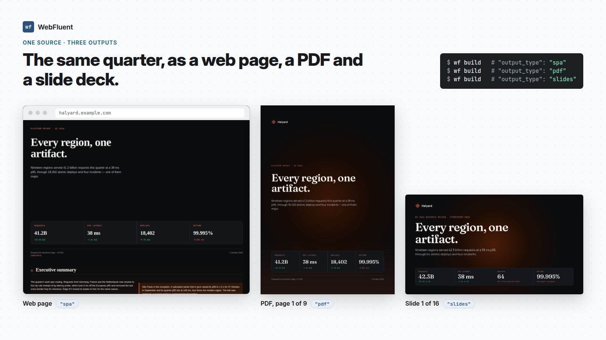
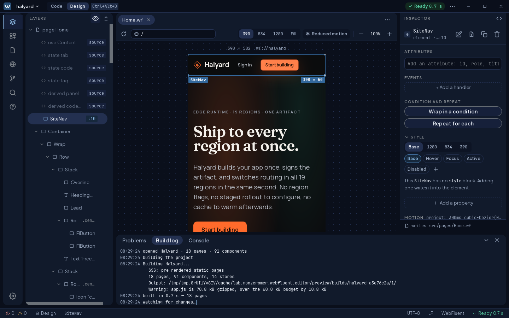

# WebFluent

**One binary. Websites, PDFs and slide decks from one language.** No Node, no framework, no build config — and no browser for your PDFs.

**[See it](https://webfluent.monzeromer.dev/showcase)** · **[Docs](https://webfluent.monzeromer.dev)** · **[Learn](https://webfluent.monzeromer.dev/learn)** · **[Recipes](https://webfluent.monzeromer.dev/recipes)** · **[Components](https://webfluent.monzeromer.dev/reference)** · **[Studio](#webfluent-studio)** · **[Guide source](site/src/pages/)**

<!-- hero: one file, three outputs -->
<p align="center"></p>

WebFluent compiles `.wf` files to a website (HTML, CSS and a small JavaScript runtime), to PDF documents with real page layout, and to slide decks. The same file can be all three. The PDFs come from WebFluent's own layout engine — flexbox and grid, shaped text, Arabic and right-to-left, embedded font subsets — built into `wf`, a 10 MB download.

```wf
type Todo { id: String, title: String, done: Bool = false }

store Todos {
    state items: [Todo] = []

    action add(title: String) {
        items = items.concat([Todo(id: uuid(), title: title)])
    }
}

page Home(path: "/", title: "Todos") {
    use Todos
    state draft = ""

    Container {
        Heading("Todos").h1
        Row(gap: .sm) {
            Input(bind: draft, placeholder: "What needs doing?").text
            Button("Add").primary { on click { Todos.add(draft)  draft = "" } }
        }
        for todo in Todos.items by todo.id {
            Card { Text(todo.title) }
        }
    }
}

app { Router }
```

That is the whole app — routing, reactivity, styling and the components included.

## Try it

**macOS and Linux** — the binary for your platform, no Rust needed:

```bash
curl -sSL https://raw.githubusercontent.com/monzeromer-lab/WebFluent/master/install.sh | bash
```

<sub>**Windows:** `irm https://raw.githubusercontent.com/monzeromer-lab/WebFluent/master/install.ps1 | iex`, then type `webfluent` where these docs type `wf` (a bare `wf` is the Windows Firewall console) · **With Rust** (everywhere Rust runs, and the way to install on Linux arm64): `cargo install webfluent` · A `.deb`, `.msi` and tarballs are attached to each [release](https://github.com/monzeromer-lab/WebFluent/releases).</sub>

```bash
wf --version
wf init my-app        # -t spa (default) · static · pdf · slides
cd my-app
wf serve              # http://localhost:3000, rebuilds on save
```

`wf build` writes the finished site to `build/` — static files any host serves. [Deploying](https://webfluent.monzeromer.dev/recipes) has GitHub Pages, Netlify, Vercel, Cloudflare and nginx.

<sub>If the shell cannot find `wf`, open a new terminal — the installer adds its directory to your `PATH` in your shell's startup file. `WF_INSTALL_DIR` installs elsewhere, `WF_VERSION` pins a release.</sub>

### With a coding agent

Every project `wf init` makes has an `AGENTS.md`, the reference for its version. For Claude Code, Codex, Cursor, Gemini CLI and the other agents that read [Agent Skills](https://agentskills.io), there is also a skill that teaches the `wf` loop, the mistakes models make most, and how good WebFluent is written. Its references cover recipes, styling and themes, testing, the diagnostics, PDFs and decks, and apps for the desktop and the phone with Tauri. A test compiles every example in them:

```bash
npx skills add monzeromer-lab/WebFluent --skill writing-webfluent -g
```

## WebFluent Studio

<p align="center"></p>

**[WebFluent Studio](https://github.com/monzeromer-lab/webfluent-studio)** is the app made for writing WebFluent. It holds a code editor, a live preview, a visual designer, Git and GitHub, the whole guide offline, and an agent that proposes changes you accept hunk by hunk. The `wf` toolchain runs inside it, so there is no terminal and no dev server to keep running.

- **One compiler.** The preview, the checks and the hints run the same compiler as `wf`, and a project built in Studio is byte-identical to `wf build`.
- **Errors come with their fix.** Each finding has the compiler's own message, a one-click fix where there is one, and **Explain** opens the guide on that diagnostic.
- **Design writes real code.** What you drag and style on the canvas becomes the `.wf` you would have written, and Code is one switch away.
- **Arabic first.** The interface is in Arabic or English, and the window mirrors right to left while code stays left to right.

Studio is a separate, closed-source app at **0.1**. Linux, macOS and Windows come first, and Android follows from the same codebase. Its builds are published on [its releases page](https://github.com/monzeromer-lab/webfluent-studio/releases): watch the repository for releases to hear when the first one lands. Questions and bugs go to [its issues](https://github.com/monzeromer-lab/webfluent-studio/issues). You do not need it: `wf` and any editor are enough, and [Editor support](#what-you-get) covers the language server.

## What you get

- **Reactivity without a framework** — signals update the exact DOM node that changed. No virtual DOM, no diffing.
- **About 150 components, already designed** — layout, navigation, tables, forms, modals, media. Styled by design tokens you can retheme in ten lines.
- **A compiler that actually checks your work** — types, props, flags, slots and events, plus lints for accessibility, SEO and dead code. A typo is an error with a line number, never a silent no-op.
- **Ships small** — the build keeps only the runtime modules your program reaches, splits a chunk per page, and precompresses everything. A page of static text ships under 4 kB of script, gzipped.
- **Four targets, one language** — SPA, pre-rendered static site, PDF, or a slide deck, by one config flag.
- **PDFs without a browser** — a paged layout engine in the binary: the same CSS cascade, flexbox and grid as the page, text shaped with kerning and ligatures, Arabic and right-to-left, tables that break between rows with their header repeated, a table of contents with page numbers, fonts embedded as searchable subsets. [Invoices, reports and résumés]({H}/showcase) in the gallery are real output.
- **Batteries included** — routing, stores, forms and validation, typed `api` services (written by hand or from an OpenAPI spec), i18n with automatic RTL, animations, dark mode.
- **A template engine for Rust and Node** — render a `.wf` template with your own data to HTML, a fragment or a PDF: `Template::from_dir("templates")?.page("Invoice")?.render_pdf(&invoice)` with any `Serialize` struct, or `npm install webfluent`. Untrusted data is escaped, and a URL that would run script is dropped.
- **Your own JavaScript, by name** — a plain `.js` file under `src/` is linked as written, and `.wf` code calls its functions directly, checked against their JSDoc. Libraries load from a CDN through `meta.scripts`; any element can be handed to a script with `mount:` and `cleanup:`.
- **Editor support** — a language server for [Zed](https://github.com/monzeromer-lab/webfluent-zed) and [VS Code](https://github.com/monzeromer-lab/webfluent-vscode): completion, hover, signature help, go to definition, references, rename, formatting, inlay types, semantic highlighting, quick fixes. Or all of it in one window, with a preview and a designer: [WebFluent Studio](#webfluent-studio).

## A taste

<details>
<summary><b>Components, props and flags</b></summary>

```wf
/// A person, at a glance.
component UserCard(_ name: String, role: String, active: Bool = true) {
    Card.elevated {
        Row(align: .center, gap: .md) {
            Avatar(initials: "U").primary
            Stack {
                Text(name).bold
                Text(role).muted
            }
            if active { Badge("Active").success }
        }
    }
}

UserCard("Monzer", role: "Developer")
```

A `.flag` sets a boolean prop or picks an enum case. A flag the component does not declare is a compile error, with the ones it does take listed.
</details>

<details>
<summary><b>Data fetching</b></summary>

```wf
type User { id: String, name: String, role: String }

resource users: [User] = http.get("/api/users")

match users {
    .loading      { Spinner }
    .failed(err)   { Alert("Failed to load").danger }
    .loaded(users) { for u in users by u.id { UserCard(u.name, role: u.role) } }
}
```

Describe a whole service once with `api`, and every call site is typed, cached, retried and cancellable.
</details>

<details>
<summary><b>Styling</b></summary>

```wf
Button("Save").primary.lg.rounded

Button("Custom") {
    style {
        background: $surface
        padding: $xl
        &:hover { background: $primary }
        @md { padding: $lg }
    }
}
```

`$token` is a design token, `{expr}` reads state. Any `.css` file under `src/` is bundled too.
</details>

<details>
<summary><b>Braces or indentation</b></summary>

A `.wf` file writes blocks in braces; a `.wfx` file writes them by indentation. Same grammar, same output — `wf fmt --to wfx` switches a project either way.

```wfx
page Home(path: "/", title: "Home")
    state count = 0
    Container
        Heading("Welcome").h1
        Button("+1").primary
            on click
                count = count + 1
```
</details>

<details>
<summary><b>PDFs and slides</b></summary>

```wf
page Deck(path: "/", title: "Q1 Review") {
    Presentation {
        TitleSlide("Q1 Review", subtitle: "March 2026")
        Slide {
            Heading("Highlights").h1
            List { Text("Revenue grew 15%")  Text("Expanded to 5 markets") }
        }
        SectionSlide("Q2 Plan").primary
    }
}
```

Set `"output_type": "slides"` (or `"pdf"`) and `wf build` writes the PDF, laid out by WebFluent's own paged engine — no browser, no external tool. Interactive components are rejected at compile time rather than silently dropped.
</details>

## CLI

```
Start and build
  wf init <name> [-t spa|static|pdf|slides]      Create a project (--locales en,ar to start translated)
  wf serve [-d DIR]                               Dev server: rebuilds on save, reloads the page
  wf build [-d DIR] [--stats] [--cache]           Compile the site, PDF, deck or custom elements
  wf start [-d DIR] [--proxy /api=URL]            Serve a build as a host would
  wf generate page|component|store|block <name>   Scaffold a file, or a whole page

Check and fix
  wf check [--format json|sarif|github]           Every finding, nothing written (--deny-warnings for CI)
  wf fix [--code C] [--dry-run]                   Apply each finding's fix
  wf explain [CODE]                               What a diagnostic means, and its fix
  wf fmt [path] [--check] [--to wfx|wf]           Format, or switch between .wf and .wfx
  wf test [path] [--update]                       Run the project's tests (in a browser when one acts)
  wf verify [path] [--budget MS]                  Load every route in headless Chrome
  wf inspect ROUTE [--do STEP]                    One page as a reader meets it, as text
  wf audit [path]                                 What the project trusts: markup, origins, storage, env
  wf migrate [path] [--check]                     Bring a project from an older major up to date

Look up
  wf components | registry | types                Components, built-ins, and what the project declares
  wf theme | motion | rules | assets              Tokens, animations, validation rules, public/ files
  wf scope FILE:LINE | translations | context     Names in scope, the translations table, the agent context
  wf commands | config schema|get|set|unset       Every command, every setting

More
  wf render TEMPLATE [--data D] [-f pdf]          Use WebFluent as a template engine
  wf api add|sync|check|eject|list                Keep a service's contract from its OpenAPI spec
  wf docs [-o OUT]                                Document the project's components, examples drawn live
```

Every command takes `--json` where it prints data; [the CLI reference](https://webfluent.monzeromer.dev/reference/cli) has each option.

## Documentation

- **[See it](https://webfluent.monzeromer.dev/showcase)** — real PDFs and decks rendered from the examples, opened straight in your browser
- **[The documentation](https://webfluent.monzeromer.dev)** — built with WebFluent itself: getting started, a tutorial that ends in a deployed site, the language, and deploying
- **[Reference](https://webfluent.monzeromer.dev/reference)** — every component, [CLI command](https://webfluent.monzeromer.dev/reference/cli), [config key](https://webfluent.monzeromer.dev/reference/config), [diagnostic](https://webfluent.monzeromer.dev/errors) and [keyword](https://webfluent.monzeromer.dev/reference/grammar)
- **[Benchmarks](https://webfluent.monzeromer.dev/benchmarks)** — WebFluent against Next.js, Astro, SvelteKit, Nuxt and React: what a site gets without a package, Lighthouse, build times, runtime speed, PDFs against headless Chrome, and what an AI agent spends to build an app. Each is a script under [`bench/`](bench/README.md), with its raw results beside it
- **[Troubleshooting](https://webfluent.monzeromer.dev/errors/troubleshooting)** and **[upgrading](https://webfluent.monzeromer.dev/errors/upgrading)**
- **[The guide's source](site/src/pages/)** — the site's pages, written in WebFluent; every code block in them is compiled by the test suite, and each page has a Markdown twin at its address with `.md`

## How it works

```
.wf source → Lexer → Parser → Type checker → Linters → Code generator → HTML + CSS + JS
                                                     → Static HTML + CSS → Paged engine → PDF
```

The compiler is Rust. The generated JavaScript is a small signal-based runtime with no dependencies, and the build keeps only the parts a program reaches.

A PDF or a deck is the page, printed: the program is rendered to the static HTML and CSS a template renders, and the paged engine lays that out on paper — the cascade, block, flex and grid layout, pagination, then text and paint. It stands on excellent crates: [taffy](https://github.com/DioxusLabs/taffy) for flexbox and grid, [rustybuzz](https://github.com/harfbuzz/rustybuzz) for text shaping, [ttf-parser](https://github.com/harfbuzz/ttf-parser) and [fontdb](https://github.com/RazrFalcon/fontdb) for fonts, [unicode-bidi](https://github.com/servo/unicode-bidi) and [unicode-linebreak](https://github.com/axelf4/unicode-linebreak) for text direction and line breaking, [usvg](https://github.com/linebender/resvg) for SVG, and [krilla](https://github.com/LaurenzV/krilla) — the PDF writer Typst's PDF export also uses — for the file itself.

## How it's built

WebFluent is designed and directed by one person, and most of its code is written with AI under that direction. What keeps it honest is checked, not promised:

- about 2,000 tests, plus browser suites that drive real pages in headless Chrome, and fuzzing of the lexer, parser, layout and formatter;
- every code block in the guide and the agent skill is parsed, type-checked and compiled by the test suite;
- CI builds every `wf init` template and the documentation site, and the build reads every script it writes back before shipping it;
- the [benchmarks](bench/README.md) are scripts with their raw results beside them, and they publish where WebFluent is behind.

## Stability

**8.x is the long-term line.** For all of 8.x the language does not break: syntax, semantics, the built-in components and their props, the config keys and the CLI's commands and flags stay as they are. Minor releases add; they never take away. 8.x gets fixes for at least twelve months after 9.0 ships, and 9.0 comes no sooner than nine months after 8.0. [STABILITY.md](STABILITY.md) has the whole promise, and what it does not cover.

To build the compiler from a clone — for an unreleased change, or to work on it:

```bash
git clone https://github.com/monzeromer-lab/WebFluent.git
cd WebFluent && cargo install --path .
```

Contributions are welcome, and the documentation most of all: a second pair of eyes on the guide's wording is the most useful help there is. See [Contributing](https://webfluent.monzeromer.dev/about/contributing) for how the project is laid out and tested, and [AGENTS.md](AGENTS.md) for what the language promises.

## License

[MPL-2.0](LICENSE). Changes to WebFluent's own files stay open; using it in a closed product is fine.

The sites, PDFs and slide decks you build with WebFluent are yours, under any license you choose. The runtime WebFluent writes into a site is MPL-2.0, which lets it ship inside closed code.
